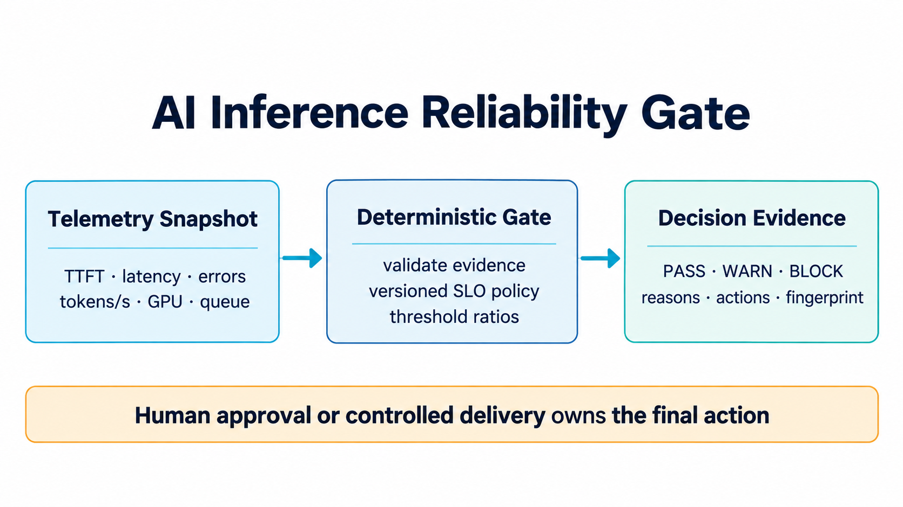

# AI Inference Reliability Gate

A deterministic production-readiness gate for AI inference services. It combines AI-specific service-level indicators—time to first token, tokens per second, accelerator saturation, queue depth, unit cost, and fallback health—with familiar SRE decision patterns.



## Why this project exists

An AI endpoint can return HTTP 200 and still provide a poor service. Users experience slow first tokens, weak generation throughput, long queues, and failed fallbacks. Platform teams also need to understand accelerator headroom and cost per unit of work. These signals frequently live in separate dashboards, making promotion and scaling decisions inconsistent.

Cloud-native platform engineering is increasingly responsible for AI workloads. Current industry guidance emphasizes observable, cost-aware, governed AI platforms, while current roles repeatedly ask for Kubernetes, Terraform, observability, incident automation, and AI/ML infrastructure. This project turns those concerns into one explainable release and capacity gate.

## What it demonstrates

- SRE thinking for production AI inference
- AI-specific SLIs: TTFT, end-to-end latency, token throughput, and fallback health
- GPU capacity and queue-headroom checks
- FinOps-aware unit-cost policy
- Deterministic `PASS`, `WARN`, or `BLOCK` decisions
- Stable reason codes, recommended actions, and evidence fingerprints
- Unit tests, CI, Docker packaging, and a safe n8n integration template

## Architecture

1. Prometheus, OpenTelemetry, cloud monitoring, or a load test produces a bounded evidence snapshot.
2. The gate validates required telemetry and compares each signal with a versioned policy.
3. Reliability breaches block promotion; capacity and cost risks warn operators.
4. The output provides reason codes, threshold ratios, actions, and an audit fingerprint.
5. A human or separately authenticated deployment system decides whether to act.

## Run locally

```bash
python -m venv .venv
source .venv/bin/activate
python -m pip install -e .
python -m ai_inference_reliability_gate --input examples/inference-snapshot.json
python -m unittest discover -s tests -v
```

Run with Docker:

```bash
docker build -t ai-inference-reliability-gate .
docker run --rm ai-inference-reliability-gate
```

## Decision model

`BLOCK` is returned when required telemetry is missing or a reliability commitment fails: error rate, time to first token, end-to-end latency, token throughput, or mandatory fallback health. `WARN` is returned when reliability remains within policy but GPU utilization, GPU memory, queue depth, unit cost, or sample size needs attention. Otherwise, the result is `PASS`.

Threshold ratios make pressure visible before a hard breach. A value of `1.0` means the metric is exactly at its configured ceiling. Policies should be versioned, reviewed, and calibrated with representative load tests rather than copied blindly from this example.

## Safe production integration

- Query metrics through a read-only observability identity.
- Generate a signed evidence snapshot for a fixed time window.
- Keep deployment credentials outside this service.
- Route `WARN` and `BLOCK` to a human approval or change-management step.
- Re-run the gate immediately before promotion.
- Pair metric thresholds with traces and logs for diagnosis.
- Validate fallback capacity under realistic load rather than checking health alone.

## Safety boundary

The project makes no cloud, Kubernetes, model, or deployment API calls. It does not scale workloads, change routing, or approve production releases. Its result is advisory evidence until a separate controlled system enforces it.

## Interview positioning

Use the project to explain how SRE and platform-engineering practices change for AI workloads. Highlight the distinction between infrastructure health and user-visible inference quality, why TTFT and token throughput belong beside error rate, how accelerator saturation and queue depth interact, and why cost and fallback readiness must be evaluated before traffic is increased.

## Current-demand basis

The project was selected after reviewing current CNCF material on AI-native platform engineering, current cloud guidance on GPU observability and generative-AI reliability, and live platform-engineering roles asking for Kubernetes, Terraform, observability, automation, and AI/ML infrastructure. See the Medium article in `social/medium-ready.md` for the source links and the engineering rationale.
